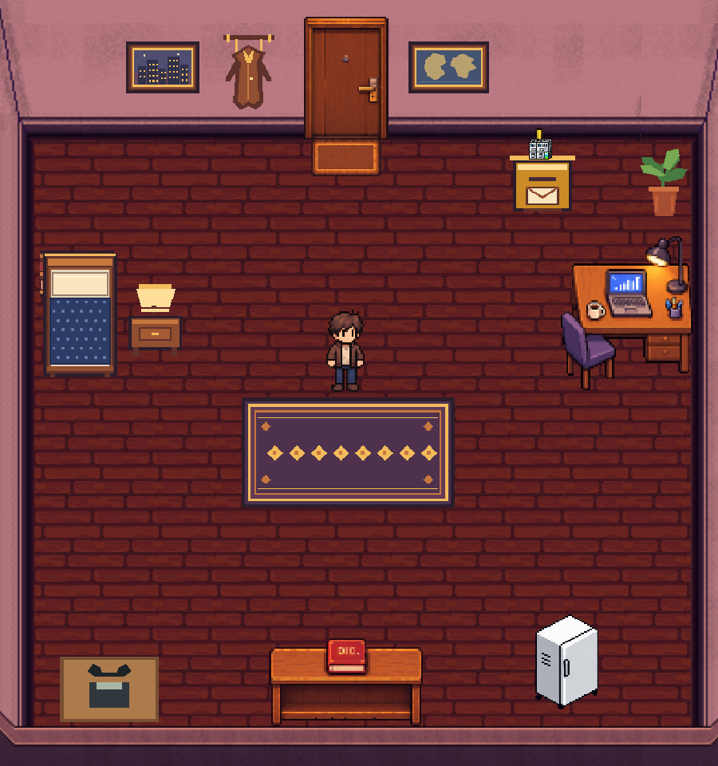
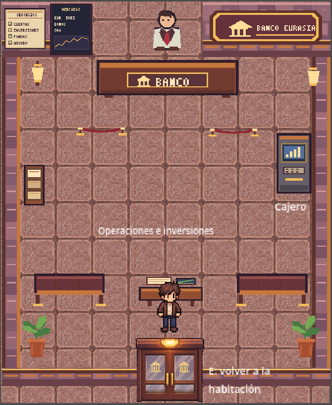

<div align="center">

# 🌍 EURASIA

### Videojuego retro sobre finanzas

*Septiembre de 2008. Doce días. Una crisis financiera a punto de estallar.*<br>
*¿Sabrás proteger tu patrimonio?*





</div>

---

## 🎮 De qué va

Vives del **5 al 16 de septiembre de 2008** en un país ficticio. Cada día llegan periódicos con noticias reales de la época (con los nombres disfrazados) y tú decides qué hacer con tus ahorros e inversiones mientras pagas facturas, comes y descansas. Al terminar, un informe revela qué pasó de verdad y de dónde salía cada noticia.

| | |
|---|---|
| 🏠 **Habitación** | Cama, buzón, portátil, nevera, diccionario financiero y teléfono |
| 📰 **Noticias** | 40 noticias del periodo, hemeroteca, rumores falsos y cuestionarios |
| 🏦 **Banco** | Cuenta, cajero, atención personal e inversiones con cotizaciones históricas |
| ❤️ **Supervivencia** | Salud, comida, gastos de casa, nómina y riesgo de bancarrota |
| 🤖 **Asistente** | Análisis de las noticias del día con Claude desde el portátil (opcional) |
| 📊 **Informe final** | Tus decisiones explicadas, con las fuentes y equivalencias reales |

## ▶️ Cómo jugar

1. Abre `godot/project.godot` con **Godot 4.7.2**.
2. Pulsa **F5**.

| Tecla | Acción |
|:---:|---|
| ⬅️ ⬆️ ➡️ ⬇️ | Moverse |
| `E` | Interactuar con objetos y personas |
| `W` | Periódicos y hemeroteca |
| `D` | Decisiones pendientes |
| `Esc` | Cerrar ventanas |

### 📦 Crear el ejecutable

En Godot: **Proyecto → Exportar… → Windows Desktop → Exportar proyecto**. Se genera `build/windows/EURASIA.exe`, un único archivo que funciona sin tener Godot instalado. La carpeta `build/` no se sube a GitHub.

> La primera vez, Godot pedirá las plantillas de exportación: **Editor → Gestionar plantillas de exportación → Descargar e instalar**.

## 🤖 Asistente con Claude (opcional)

Copia `.env.example` como `.env` y pon tu `ANTHROPIC_API_KEY` (el `.env` nunca se sube a Git). Después, con el `.venv` activado:

```bash
pip install -r requirements.txt
python servidor_asistente/servidor.py
```

Más detalles en [servidor_asistente/README.md](servidor_asistente/README.md).

## 🗂️ Estructura

```
Eurasia/
├── godot/               Proyecto de Godot: escenas, sistemas, datos y assets
├── arte/                Referencias y originales en alta resolución
├── docs/                Diseño, estado del proyecto y fuentes históricas
├── servidor_asistente/  Servicio local del asistente
└── tools/               Generadores y validadores (atlas, pixel art, noticias)
```

## 🤝 Trabajo en equipo

```bash
git pull                                # antes de empezar (imprescindible)
git add .                               # o solo lo tuyo: git add <carpeta/archivo>
git commit -m "Modificación: descripción del cambio"
git push
```

Dependencias de Python, con el venv activado:

```bash
pip install -r requirements.txt         # instalar
pip freeze > requirements.txt           # actualizar si añades alguna
```

## 📚 Documentación

- [Estado del proyecto](docs/ESTADO_PROYECTO.md)
- [Diseño del juego](docs/EURASIA_DISENO_DEL_JUEGO.md)
- [Seguimiento técnico](docs/EURASIA_SEGUIMIENTO.md)
- [Fuentes históricas](docs/REGISTRO_FUENTES_HISTORICAS.md)

---

<div align="center">
<sub>Licencia <a href="LICENSE">MIT</a> · Hecho con Godot</sub>
</div>
